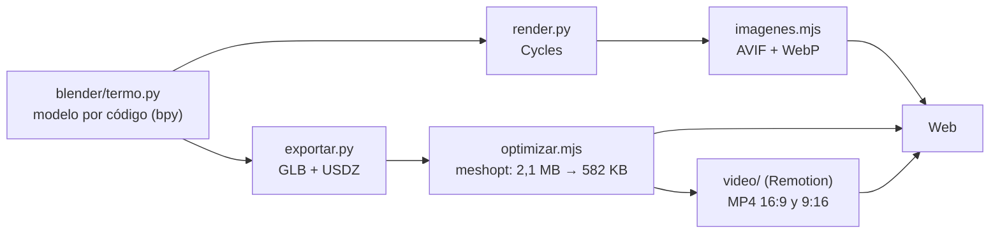
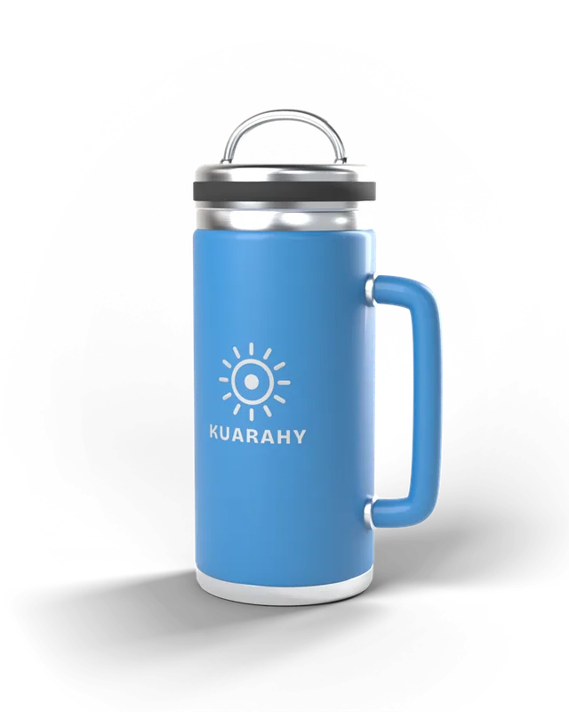
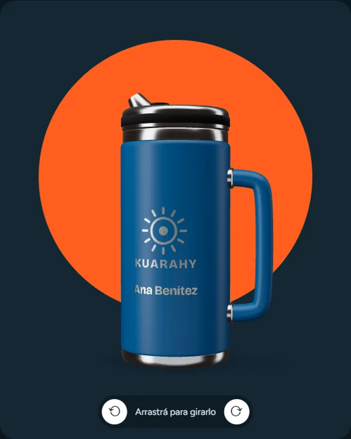
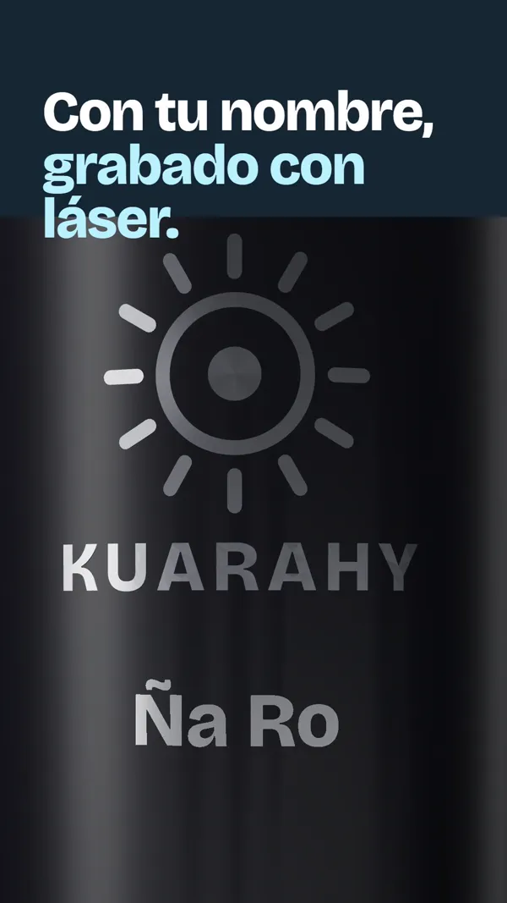
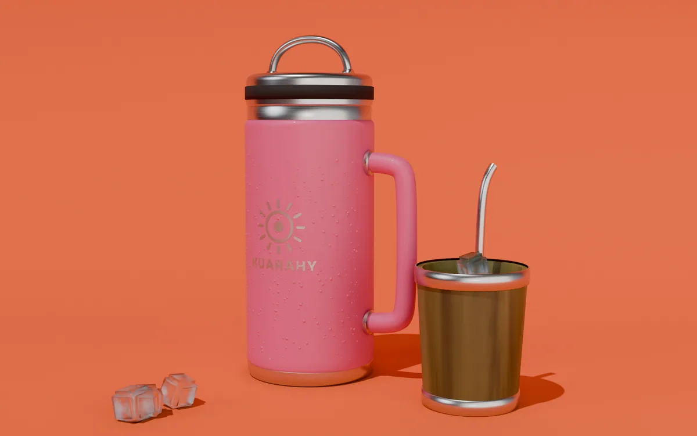
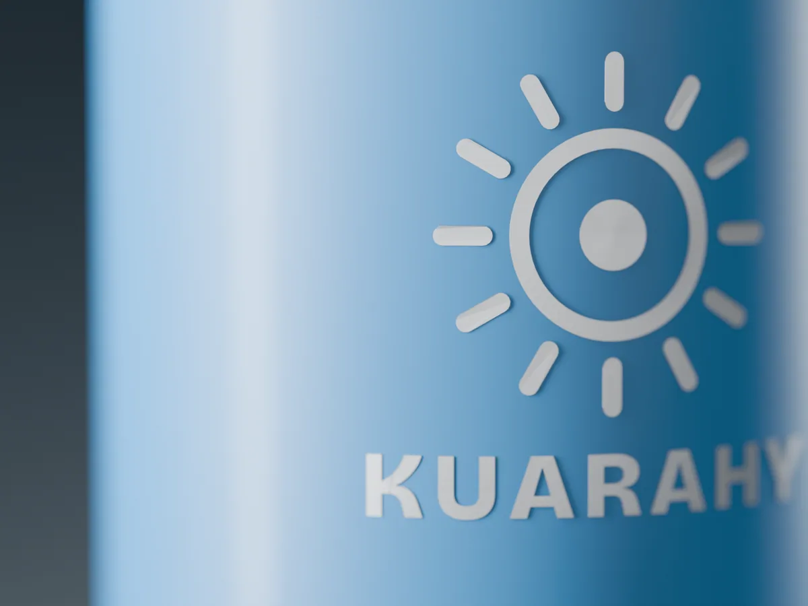
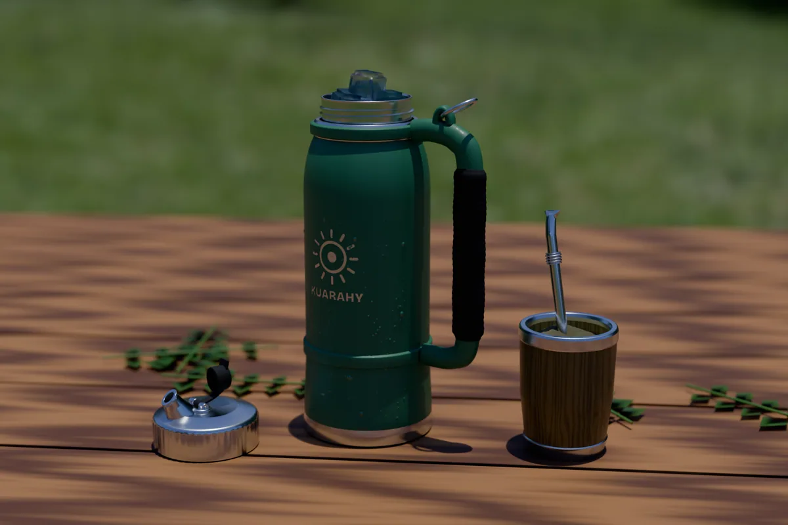
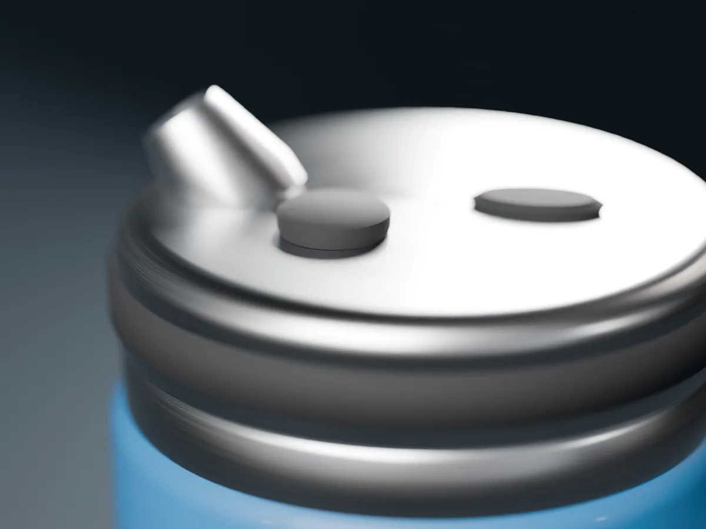
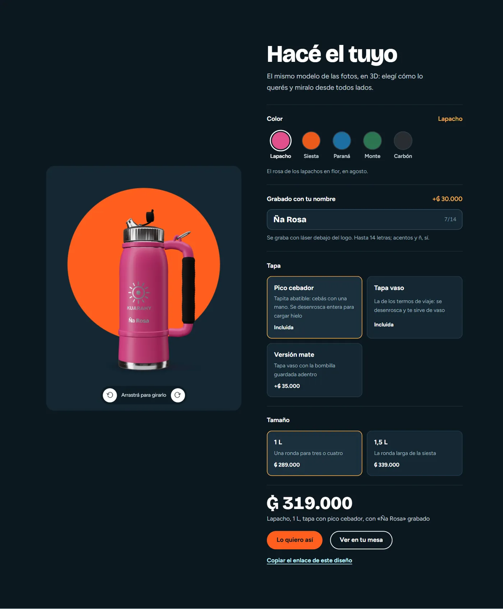
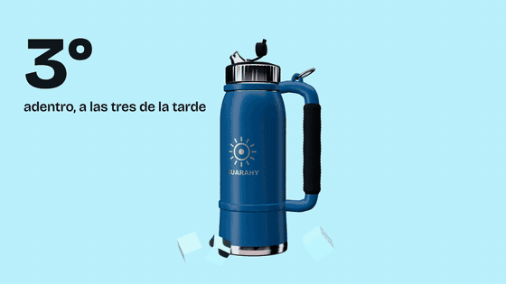

# Kuarahy · El termo que le gana al sol

[English below](#english)

Sitio de producto para **Kuarahy**, un termo de acero para tereré hecho en Paraguay que mantiene el hielo 24 horas. *Kuarahy* significa "sol" en guaraní.

> Producto, marca, precios y reseñas **ficticios**. Proyecto de portafolio de diseño, 3D y desarrollo frontend.


## Un solo modelo para todo

El termo se modela **una sola vez, con código**, en Blender. Ese mismo modelo es:

1. **las fotos de producto** (Cycles),
2. **el 3D interactivo** de la web (GLB en React Three Fiber) y la **realidad aumentada** (`<model-viewer>`),
3. **el comercial** (Remotion + `@remotion/three`).

Así el producto es idéntico en cada pieza, como en una marca real.



| Foto de producto (Blender, Cycles) | El mismo modelo en la web (three.js) | El mismo modelo en el comercial (Remotion) |
| --- | --- | --- |
|  |  |  |

### 1. Blender: el termo por código (`blender/`)

No hay nada modelado a mano: `termo.py` arma cada pieza con `bpy` y `bmesh`. La versión 3 es un rediseño pensado como diseñador industrial (la anterior se leía como un jarro de cerveza):
- **Proporción de termo:** 9,4 cm de diámetro y 30 cm de alto en 1 L (38 cm en 1,5 L), base de acero un 5 % más ancha para que no se vuelque lleno y hombro suave hasta el cuello.
- **Manija para toda la mano:** agarre vertical de 11 cm con funda de goma estriada y cuatro huecos para los dedos, 2,9 cm de luz, tomada con dos aros (cuello y cuerpo). Arriba, una **argolla de acero** para colgarlo de la mochila o del alambrado de la cancha.
- **Tres tapas que enroscan en el mismo cuello:**
  - **Pico cebador:** labio cortagotas con la boca al bies, tapita de goma con tapón, bisagra de tres nudillos con su perno a la vista y estrías para abrir con la mano mojada.
  - **Tapa vaso**, la clásica de los termos de viaje.
  - **Versión mate:** tapa vaso con la bombilla guardada, que asoma por un pasante de silicona.
- **Boca ancha de 6,5 cm con rosca** (se ve con la tapa sacada): por ahí entra el hielo.
- **Bombilla** con pico aplastado y curvado, virola labrada y filtro de resorte; **guampa de palo santo** torneada, con veta, surcos y virolas de acero arriba y abajo.
- **Cantos con radio real** en todos los perfiles (`filetear()`, de 0,3 a 4 mm): no quedan aristas perfectas de CG. Junta de goma entre tapa y collar.
- **Sol y KUARAHY grabados de verdad:** en las fotos, un booleano cava la figura 0,3 mm en la pintura y se ven las paredes del corte; en la web va una versión liviana. El texto sale de la tipografía de la marca (Bricolage Grotesque Extra Bold, OFL) y se **envuelve analíticamente sobre el cilindro**.
- **Materiales PBR**: pintura en polvo con cáscara de naranja y manchas de uso en la rugosidad; acero cepillado en anillos con anisotropía radial; goma con textura de molde. Los colores son un parámetro (los mismos cinco hex de la web).
- Una **banda con UV** debajo del logo, que la web usa para pintar el nombre del cliente.

`render.py` arma las escenas con calidad configurable (`--calidad boceto|final`):
- **Estudio:** fondo transparente con sombra de contacto, una por color.
- **Hero:** el termo transpirando, con el pico abierto, la guampa con yerba y bombilla, y hielo suelto al lado (nunca en la guampa).
- **Macro:** el grabado con luz rasante y el pico cebador.
- **Ambiente:** mesa al aire libre con la boca ancha abierta y cargada de hielo, la tapa al lado (HDRI *Noon Grass* de Poly Haven).
- **Referencias** (`--escena referencias`): fondo neutro, cinco colores × cinco ángulos, más las otras tapas, la boca abierta y la guampa con la bombilla. Van a `Projects/Audiovisual/editor-video/referencias-kuarahy/` para generar escenas con personas en Buzzy usando el producto exacto.

| | |
| --- | --- |
|  |  |
|  |  |

Tiempos en esta notebook (i7-1355U, **solo CPU**: la GPU integrada no sirve para Cycles):
- 3 a 4,5 minutos por foto final (128 muestras + OpenImageDenoise).
- Las 9 fotos: unos 35 minutos; las 29 referencias (64 muestras): cerca de una hora.
- Los bocetos (mitad de resolución, 24 muestras) tardan 10 a 15 segundos.

### 2. Web

- **Hacé el tuyo:**
  - Visor 3D con React Three Fiber y drei.
  - Iluminación de estudio armada con paneles (`Lightformer`), sin bajar un HDRI.
  - Personalizador de color, **nombre grabado en vivo** (hasta 14 caracteres, con ñ y acentos), tapa (pico cebador, vaso o mate) y tamaño, con el precio que cambia.
  - El diseño se guarda en la URL (`?color=parana&nombre=Ana&tapa=pico&tamano=15L`): se puede compartir y volver a él.
  - Botones accesibles para girar el termo.
- **Carga diferida:**
  - El 3D se baja recién cuando la sección está por aparecer. Mientras tanto, y en celulares con ahorro de datos, poca memoria o `prefers-reduced-motion`, se ve el render de Blender del mismo color.
  - Three.js no entra en la carga inicial: la página arranca con 78 KB de JS comprimido.
- **Ver en tu mesa**, con `<model-viewer>` (se carga al tocar el botón):
  - **Android:** WebXR, con el color y el nombre elegidos; si no hay WebXR, Scene Viewer.
  - **iPhone:** Quick Look.
  - **Computadora:** un QR con el mismo diseño para seguir en el celular.
  - El termo aparece a tamaño real (`ar-scale="fixed"`).
- La escena **"Un día de enero"** (scroll) y la portada usan los renders del color elegido.
- **Galería** con zoom (`<dialog>` nativo), **comercial**, reseñas de ejemplo marcadas como demo, garantía y preguntas frecuentes.



### 3. Comercial (`video/`, Remotion)

Spot de 28 s en **1920×1080** y **1080×1920**, con el mismo GLB en `@remotion/three`. Todo se anima con `useCurrentFrame()`, sin animaciones que corran solas.

Guion:
1. El calor de enero en Ciudad del Este (41° afuera).
2. El termo en contraluz.
3. El hielo cae: "3° adentro".
4. Los cinco colores, en ritmo.
5. Un nombre que se graba letra por letra.
6. Cierre: "Kuarahy. El termo que le gana al sol."

Sin música: el diseño sonoro (calor, ráfaga, hielo, tics y golpe final) está **sintetizado con FFmpeg** a partir de ruido y tonos, así no hay licencias de por medio.

[](public/video/kuarahy-spot-16x9.mp4)

## Cómo regenerar todo

```bash
# 1) Fotos y modelo (Blender 5.x)
py blender/descargar_assets.py
blender -b --factory-startup --python blender/render.py -- --escena todas --calidad final
blender -b --factory-startup --python blender/exportar.py
node blender/optimizar.mjs      # GLB con meshopt → public/modelos/
node blender/imagenes.mjs       # renders → AVIF/WebP → public/img/renders/

# 2) Comercial
cd video && npm install
npx remotion render Spot-16x9 out/kuarahy-spot-16x9.mp4 --gl=angle
npx remotion render Spot-9x16 out/kuarahy-spot-9x16.mp4 --gl=angle

# 3) Web
npm install && npm run dev      # npm test: pruebas del personalizador
```

## Decisiones

- **De SVG a 3D real.** La primera versión dibujaba el termo en SVG para no cargar three.js. Ahora el 3D tiene un motivo (girarlo, personalizarlo y verlo en tu mesa) y se carga diferido: la portada sigue siendo una imagen liviana.
- **meshopt en lugar de Draco:** el decodificador entra en el paquete de JS, sin bajar WebAssembly de otro dominio. Los modelos de realidad aumentada van solo cuantizados (560 a 690 KB con el modelo nuevo), porque Scene Viewer y Quick Look no garantizan meshopt.
- **Gotas de condensación:** como agua con transmisión, a esta escala la luz quedaba atrapada y salían puntos negros. Son la misma pintura "mojada" (brillo y laca a pleno), que es lo que se ve en una foto real.
- **Color fiel en el estudio:** la transformada AgX lava los colores saturados en las zonas iluminadas, así que las fotos de estudio usan la transformada *Standard* para que el Lapacho sea el Lapacho de la web.

## Créditos

- HDRI *Noon Grass* y *Studio Small 09*, de [Poly Haven](https://polyhaven.com) (CC0).
- Tipografías [Bricolage Grotesque](https://fonts.google.com/specimen/Bricolage+Grotesque) y [Figtree](https://fonts.google.com/specimen/Figtree) (SIL Open Font License).
- Sonido del comercial sintetizado con FFmpeg. Sin música de terceros.

Diseño, 3D y desarrollo: [William Zarza](https://github.com/williamzarza2003).

---

## English

**Kuarahy** ("sun" in Guaraní) is a product site for a fictional stainless-steel tereré flask made in Paraguay that keeps ice for 24 hours.

**One model for everything.** The flask is modeled **once, in code**, with Blender's Python API (`bpy` + `bmesh`): version 3 was redesigned with an industrial-design mindset: real flask proportions (30 cm tall, wider steel base, soft shoulder), a full-hand handle with a ribbed rubber grip and a steel carry ring, three lids on the same wide-mouth thread (pour spout with a drip-cutting lip and a hinged flip cap, a travel-cup lid, and a "mate" lid that stores the bombilla), filleted edges everywhere, and a logo boolean-cut 0.3 mm into the powder coat. PBR materials: orange-peel powder coat, ring-brushed anisotropic steel and molded rubber. That same model produces:

1. **Product photos** rendered with Cycles (transparent studio shots in five colors, a hero shot with condensation and hard noon light, two macros and an outdoor scene with a CC0 HDRI).
2. **A 3D customizer** in React Three Fiber: color, a **live engraved name** drawn onto a UV-mapped band through a `CanvasTexture`, lid and size with a live price. The design is stored in the URL so it can be shared. The GLB is meshopt-compressed from 2.1 MB to 582 KB and lazy-loaded; until it loads, and on low-end devices, the matching Blender render is shown.
3. **"See it on your table"** AR with `<model-viewer>` (WebXR or Scene Viewer on Android, Quick Look on iOS, a QR code on desktop), at real size.
4. **A 28-second ad** in 16:9 and 9:16 built with Remotion and `@remotion/three` from the same GLB, with sound design synthesized in FFmpeg (no licensed music).

Stack: Blender 5 (Python), Cycles, glTF-Transform + meshoptimizer, sharp (AVIF/WebP), React 19, TypeScript, Vite, React Three Fiber, drei, `<model-viewer>`, Remotion, Vitest.

Run: `npm install && npm run dev`. The full pipeline (renders, GLB export, compression, video) is described in the Spanish section above. Credits: Poly Haven (CC0 HDRIs), Bricolage Grotesque and Figtree (OFL). Design, 3D and code by William Zarza.
