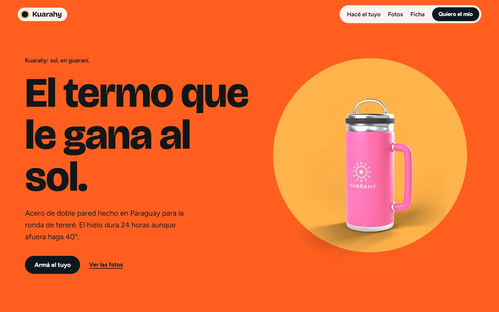
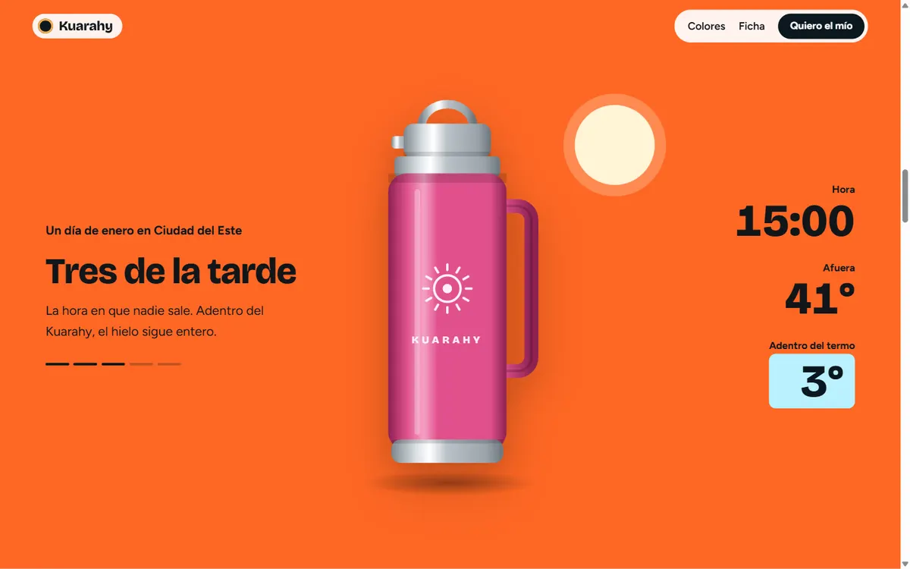
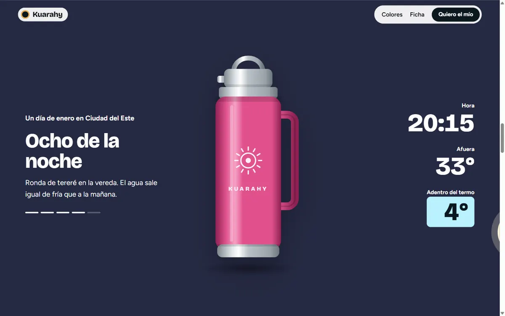
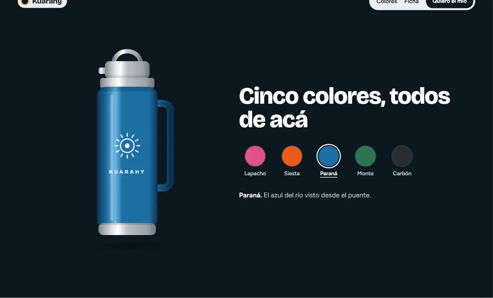
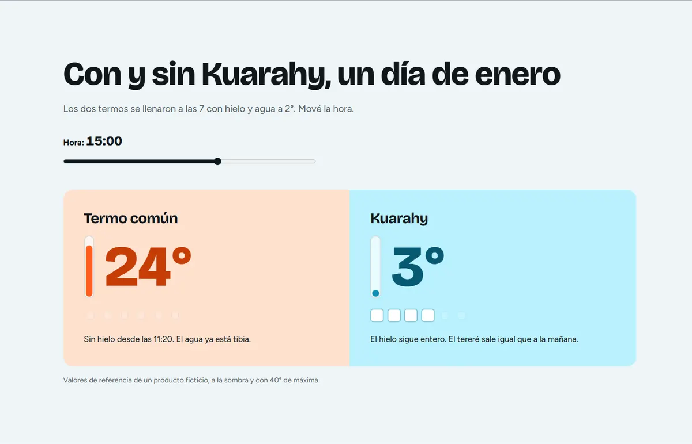

# Kuarahy · El termo que le gana al sol

Landing publicitaria para **Kuarahy**, un termo de acero para tereré hecho en Paraguay que mantiene el hielo 24 horas. *Kuarahy* significa "sol" en guaraní: es el termo que le gana al sol.

> Producto, marca y precios **ficticios**. Proyecto de portafolio de diseño y desarrollo frontend.



## La idea

Un producto protagonista y una sola narrativa al hacer scroll: **un día de enero en Ciudad del Este, contado por el termo**. Mientras bajás, el sol cruza el cielo, la hora avanza de las 7 de la mañana al día siguiente y dos números cuentan la historia: la temperatura de afuera sube a 41° y la de adentro del termo apenas se mueve.

| Tres de la tarde | Ocho de la noche |
| --- | --- |
|  |  |

## Secciones

- **Portada** con el termo dibujado en SVG sobre un sol plano.
- **Un día de enero**: escena fija (`position: sticky`) de cinco capítulos. Un único cálculo por cuadro traduce el scroll en un progreso de 0 a 1 que mueve el sol, el color del cielo y los números, sin volver a renderizar React. De noche el texto pasa a claro según la luminancia del cielo.
- **Cinco colores** tomados del paisaje: Lapacho, Siesta, Paraná, Monte y Carbón. El color elegido se aplica en todos los termos de la página y en la lista de espera.
- **Con y sin Kuarahy**: comparación con un control de hora; los termómetros y el hielo responden a lo que hace el usuario.
- **La guampa y la bombilla**: el equipo completo, también en SVG.
- **Ficha técnica** clara, en una lista de definiciones.
- **Quiero el mío**: lista de espera de demo con validación (no guarda datos).





## Decisiones

- **SVG en lugar de 3D.** El termo es un SVG de unos pocos KB con sombreado cilíndrico por degradados y colores en variables CSS. Se ve nítido en cualquier pantalla, carga al instante en celulares y cambia de color sin volver a dibujarse. Un render con three.js agregaba cientos de KB para un objeto que es, básicamente, un cilindro.
- **Paleta propia:** el naranja de la siesta como campo plano contra el cian del hielo, con azul noche para el contraste. Los únicos degradados son el sombreado del producto.
- **Tipografía:** Bricolage Grotesque para los titulares y Figtree para el texto.
- **Movimiento con criterio:** la escena es el único momento animado. Con `prefers-reduced-motion` se reemplaza por una lista de capítulos que se lee de corrido.

## Stack

React 19 · TypeScript · Vite · CSS puro · SVG

## Correr en local

```bash
npm install
npm run dev
```

## Estructura

```
src/
  App.tsx                 secciones de la página
  components/Termo.tsx    el termo en SVG, con colores por variables CSS
  components/Escena.tsx   la narrativa con scroll
  components/Equipo.tsx   guampa y bombilla en SVG
  data/variantes.ts       los cinco colores
docs/capturas/            capturas para este README
```

Diseño y desarrollo: [William Zarza](https://github.com/williamzarza2003). Ilustraciones propias en SVG; no se usaron fotos de terceros.
